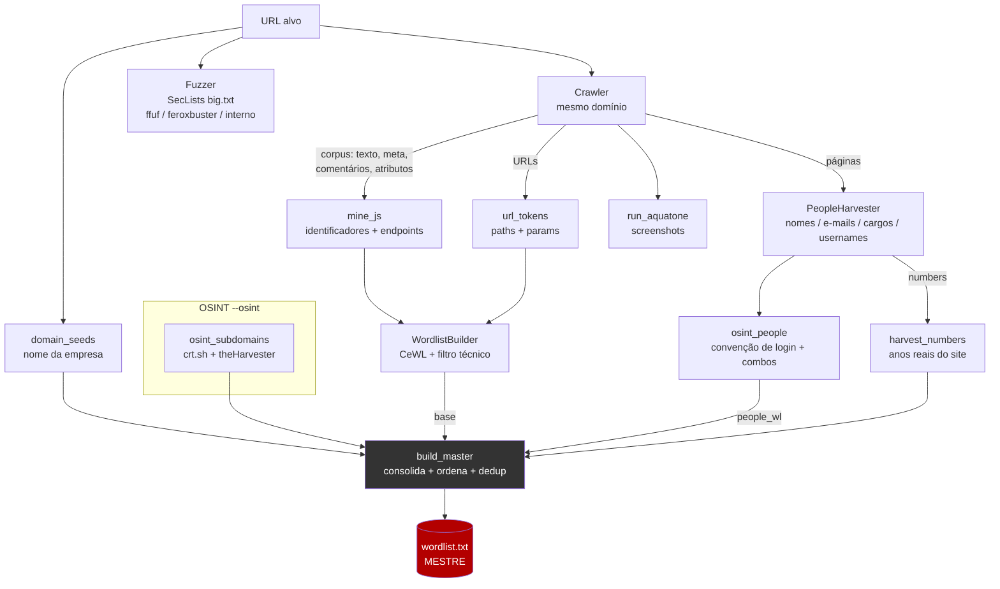
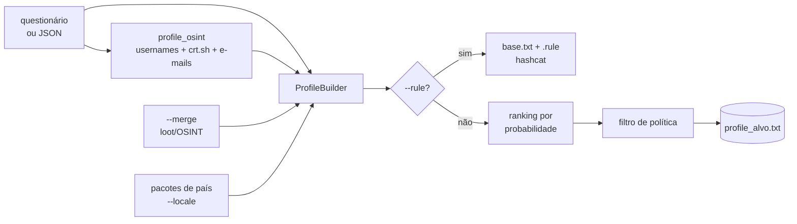

# 🦴 Necroscan

> **Visual recon + wordlist reaper** — rastreia um site, bate screenshots de tudo,
> minera as palavras do próprio alvo e gera wordlists completas (estilo **CeWL + cupp**),
> fazendo ainda **OSINT de funcionários** e **fuzzing de diretórios**. Tudo numa ferramenta só.

<p align="center">
<code>crawl → screenshot → mine → OSINT → fuzz → <b>uma wordlist mestre</b></code>
</p>

---

## 📑 Índice

- [Por que o Necroscan existe](#-por-que-o-necroscan-existe)
- [Instalação](#-instalação)
- [Começo rápido](#-começo-rápido)
- [Arquitetura](#-arquitetura)
- [Decisões de design (o "porquê")](#-decisões-de-design-o-porquê)
- [Modo Scan — passo a passo](#-modo-scan--passo-a-passo)
- [Modo Profile (estilo cupp)](#-modo-profile-estilo-cupp)
- [A wordlist mestre](#-a-wordlist-mestre)
- [Saída (loot)](#-saída-loot)
- [Referência de flags](#-referência-de-flags)
- [Integração com hashcat](#-integração-com-hashcat)
- [Notas sobre lockout e password spraying](#-notas-sobre-lockout-e-password-spraying)
- [Aviso legal](#-aviso-legal)

---

## 🎯 Por que o Necroscan existe

Num recon de web/AD, você normalmente encadeia **várias** ferramentas: `aquatone` pra
screenshots, `CeWL` pra tirar palavras do site, `cupp` pra wordlist por perfil,
`theHarvester`/`crt.sh` pra OSINT, `ffuf` pra fuzzing — e depois cola tudo na mão.

O Necroscan junta esse fluxo num pipeline único e, no fim, entrega **uma wordlist
mestre** já priorizada. O princípio central:

> **A melhor wordlist não vem de um dicionário genérico — vem do próprio alvo.**
> Palavras do site, nomes e cargos dos funcionários, convenção de login da empresa,
> anos que aparecem nas páginas. O Necroscan extrai esse material e o transforma em
> candidatos de senha/usuário realistas.

---

## 📦 Instalação

```bash
# obrigatório
pip install requests beautifulsoup4

# opcionais (habilitam fases extras)
go install github.com/michenriksen/aquatone@latest   # screenshots
# ffuf ou feroxbuster                                  # fuzzing mais rápido
# theHarvester                                          # OSINT externo
# SecLists                                              # big.txt p/ fuzzing (--fuzz)
```

- **Python 3.8+**
- `aquatone` precisa de um **chromium/chrome** (autodetectado).
- Sem `aquatone`/`ffuf`/`theHarvester`/SecLists, a ferramenta roda igual — só pula/substitui a fase correspondente (há um fuzzer interno em Python de fallback).

---

## 🚀 Começo rápido

```bash
# recon completo: crawl + wordlist + OSINT + screenshots + fuzzing
python3 necroscan.py https://alvo.com --osint --fuzz

# só a wordlist (sem screenshots)
python3 necroscan.py https://alvo.com --no-screens

# wordlist por perfil de um alvo (estilo cupp), com pacotes de país
python3 necroscan.py --profile --locale br,us,global
```

---

## 🏗 Arquitetura

O Necroscan é um **pipeline de fases**. Cada fase enriquece um *corpus* comum de
palavras; no fim, o `build_master` consolida tudo em uma lista ordenada por relevância.



### Modo Profile (caminho separado, não precisa de URL)



### Componentes (classes e funções)

| Componente | Papel |
|---|---|
| `Crawler` | Rastreia o mesmo domínio; coleta URLs, texto, meta, comentários, atributos e `.js`. |
| `Crawler.mine_js` | Baixa os `.js` e extrai identificadores (quebra camelCase/snake) e endpoints de API. |
| `WordlistBuilder` | Conta frequência das palavras (CeWL) e aplica mutações (leet, anos, sufixos, especiais); tem o **filtro técnico**. |
| `PeopleHarvester` | Extrai funcionários (nomes, e-mails, cargos) e **usernames** de artefatos; infere a **convenção de login**. |
| `Fuzzer` | Fuzzing de diretórios/arquivos com o `big.txt`; usa ffuf/feroxbuster ou fuzzer interno. |
| `ProfileBuilder` | Wordlist por perfil (cupp++): datas, combinações, ranking, política, pacotes de país, regras hashcat. |
| `osint_subdomains` | Subdomínios via crt.sh + theHarvester. |
| `domain_seeds` / `url_tokens` / `harvest_numbers` | Seeds da empresa, tokens de URL e números reais do site. |
| `build_master` | **Consolida tudo** numa wordlist deduplicada e ordenada por relevância. |

### Ordem das fases (modo scan)

```
Fase 1  Crawl ──▶ mine_js ──▶ osint_subdomains (--osint)
Fase 2  WordlistBuilder (conteúdo, CeWL)
Fase 3  PeopleHarvester ──▶ osint_people (--osint)
        └─▶ build_master  →  wordlist.txt (MESTRE)
Fase 4  run_aquatone (screenshots)
Fase 5  Fuzzer (SecLists big.txt)
```

---

## 🧠 Decisões de design (o "porquê")

**1. Pipeline de fases com um corpus compartilhado.**
Cada fase só *acrescenta* palavras a um corpus comum, e a consolidação é um passo
único no fim. Assim dá pra ligar/desligar fases (`--no-js`, `--no-people`,
`--no-screens`, `--fuzz`) sem quebrar o resto, e a ordem de relevância fica
centralizada em um lugar só (`build_master`).

**2. Uma wordlist mestre, ordenada por relevância.**
Em vez de cuspir vários arquivos pro operador juntar na mão, o padrão é **uma**
`wordlist.txt` com o mais provável no topo (seeds da empresa → palavras do site →
funcionários/usernames → compostas → mutações). Os componentes separados só saem com
`--keep-parts`. Motivo: numa quebra, o que importa é acertar cedo.

**3. Separar palavras "pessoais" de "dicionário".**
Nomes, pet, empresa e usernames entram no **combinador par-a-par** (geram senhas
compostas como `acmeseguranca`); já os pacotes de país/`--locale` entram **isolados**.
Se tudo fosse cruzado, a lista explodia com lixo inútil (ex: `acmepassword`). Essa
divisão foi o que derrubou uma geração de 11,8M → 1,6M mantendo a qualidade.

**4. Filtro técnico ligado por padrão.**
Minerar `.js` traz muito ruído de biblioteca (`stroke`, `opacity`, `querySelector`…).
O `TECH_STOP` remove esses termos **sem** tocar em palavras valiosas (`admin`, `login`,
`senha`, `password`). Desligável com `--no-tech-filter`.

**5. Convenção de login inferida, não chutada.**
O `PeopleHarvester` cruza artefatos do site (ex: `/images/headshots/rweston.jpg`,
`mailto:`) com os nomes capturados pra descobrir o **padrão real** da empresa
(`flast`, `first.last`, …). Isso vale mais que gerar todas as convenções no escuro.

**6. Números reais do alvo como sufixos dinâmicos.**
`harvest_numbers` pega anos/códigos que aparecem no site (ex: ano de fundação) e usa
como sufixo nas mutações — senhas corporativas costumam ter justamente esses números.

**7. Ferramentas externas são opcionais, com fallback.**
`aquatone`, `ffuf`/`feroxbuster`, `theHarvester` e SecLists **melhoram** o resultado,
mas a ferramenta roda sem eles: fuzzer interno em Python, crt.sh sem dependência, e as
fases que exigem binário ausente apenas avisam e seguem.

**8. Modo Profile pensado pra hashcat.**
Pré-expandir milhões de candidatos é desperdício. Com `--rule`, o Necroscan entrega
uma **lista-base enxuta + um `.rule`** (com leet, especiais e os **anos do alvo** como
regras) pra o hashcat mutar na GPU — ordens de magnitude mais rápido.

---

## 🔍 Modo Scan — passo a passo

```bash
python3 necroscan.py https://alvo.com [opções]
```

1. **Crawl** (`--depth`, `--max-pages`): visita o mesmo domínio, coleta URLs, texto, meta, comentários e atributos.
2. **Mineração de `.js`** (padrão; `--no-js` desliga): identificadores + endpoints (`endpoints.txt`).
3. **OSINT externo** (`--osint`): subdomínios via crt.sh (+ theHarvester), vira seed.
4. **Wordlist de conteúdo**: frequência + filtro técnico.
5. **Funcionários** (`--osint` para usernames/convenção): nomes, e-mails, cargos.
6. **Consolidação**: `wordlist.txt` mestre.
7. **Screenshots** (`--no-screens` pula): `aquatone`.
8. **Fuzzing** (`--fuzz`): `big.txt` do SecLists.

---

## 🧬 Modo Profile (estilo cupp)

Gera wordlist a partir do **perfil de um alvo** — não precisa de URL.

```bash
python3 necroscan.py --profile                          # interativo (PT-BR)
python3 necroscan.py --profile-file alvo.json           # não-interativo
python3 necroscan.py --profile --locale br,us,global    # pacotes de país
python3 necroscan.py --profile --policy "8,upper,digit,special" --max-words 50000
python3 necroscan.py --profile --rule                   # saída p/ hashcat
python3 necroscan.py --profile --merge loot/alvo        # mistura OSINT já coletado
```

Pergunta: nome, sobrenome, apelido, nascimento, parceiro(a), filhos/pets, empresa,
palavras extras. Depois gera:

- **Datas** em vários formatos (ano, AA, DDMM, DDMMAAAA, idade…).
- **Combinações par-a-par** (multi-pessoa: alvo + família + OSINT).
- **Leet, capitalização, especiais**.
- **Ranking por probabilidade** (nome+ano+especial no topo).
- **Filtro de política** (`--policy "8,upper,digit,special"`).
- **Pacotes de país** (`--locale br,us,es,global|all`).
- **OSINT automático** sobre os dados (usernames do alvo/parceiro, crt.sh, e-mails).

---

## 🗂 A wordlist mestre

`wordlist.txt` consolida, **nesta ordem de relevância**:

1. **Seeds** — nome da empresa/domínio + labels de subdomínios (crt.sh).
2. **Palavras do site** por frequência (CeWL) — inclui identificadores minerados dos `.js`.
3. **Funcionários** — nomes, logins de e-mail, cargos, **usernames** e combinações.
4. **Senhas compostas** — palavra+palavra (`acmeseguranca`, `segurancaAcesso`).
5. **Mutações** — leet, capitalização, **anos reais do site**, sufixos e especiais.

Tudo deduplicado. `--plain` corta as mutações; `--keep-parts` salva os componentes separados.

---

## 📁 Saída (loot)

Em `loot/<domínio>/`:

| Arquivo | Conteúdo |
|---|---|
| `wordlist.txt` | **Wordlist mestre** (tudo consolidado, por relevância) |
| `urls.txt` | URLs encontradas no crawl |
| `endpoints.txt` | Endpoints extraídos dos `.js` |
| `usernames.txt` | Usernames dos funcionários (todas as convenções) — `--osint` |
| `osint_people.txt` | Relatório por pessoa (usernames prováveis + e-mail) — `--osint` |
| `emails.txt` | E-mails descobertos / candidatos |
| `subdomains.txt` | Subdomínios (crt.sh / theHarvester) — `--osint` |
| `wordlist_counts.txt` | Palavra + frequência (CeWL `-c`) — `--with-count` |
| `screenshots/aquatone_report.html` | Relatório visual do aquatone |
| `fuzz/` | Resultados do fuzzing |
| `part_*.txt` | Componentes separados — `--keep-parts` |

---

## 🎛 Referência de flags

### Scan
| Flag | Descrição |
|---|---|
| `--depth N` | Profundidade do crawl (padrão 2) |
| `--max-pages N` | Máximo de páginas (padrão 300) |
| `--out DIR` | Diretório de saída (padrão `loot/<domínio>`) |
| `--timeout S` | Timeout por request (padrão 10) |

### Wordlist
| Flag | Descrição |
|---|---|
| `--plain` | Sem mutações (lista enxuta) |
| `--keep-parts` | Salva também os componentes separados |
| `--with-numbers` | Inclui tokens alfanuméricos |
| `--lowercase` | Força minúsculas |
| `--min-len` / `--max-len` | Tamanho mínimo/máximo de palavra |
| `--no-combine` | Não gerar senhas compostas |
| `--no-tech-filter` | Não filtrar termos técnicos de JS/CSS |
| `--with-count` | Salva `wordlist_counts.txt` |

### OSINT
| Flag | Descrição |
|---|---|
| `--osint` | Subdomínios (crt.sh) + usernames/e-mails dos nomes capturados |
| `--email-domain DOM` | Gera candidatos de e-mail com esse domínio |
| `--no-people` | Não incluir funcionários |

### JS / Screenshots / Fuzzing
| Flag | Descrição |
|---|---|
| `--no-js` | Não minerar `.js` |
| `--no-screens` | Pula screenshots |
| `--aquatone PATH` / `--chrome-path PATH` | Caminhos explícitos |
| `--threads N` | Threads do aquatone |
| `--fuzz` | Fuzzing com big.txt do SecLists |
| `--fuzz-wordlist PATH` | Wordlist de fuzzing |
| `--fuzz-ext php,bak,txt` | Extensões |
| `--fuzz-codes 200,301,403` | Códigos HTTP aceitos |
| `--fuzz-threads N` | Threads do fuzzer |
| `--download-wordlist` | Baixa o big.txt se não achar |

### Profile
| Flag | Descrição |
|---|---|
| `--profile` | Modo cupp interativo |
| `--profile-file JSON` | Perfil via JSON |
| `--merge PATH` | Mistura arquivo/pasta de OSINT |
| `--locale br,us,es,global\|all` | Pacotes de país |
| `--policy "8,upper,digit,special"` | Filtro de política de senha |
| `--max-words N` | Limita a lista (topo do ranking) |
| `--rule` | Saída em base + `.rule` do hashcat |

---

## ⚡ Integração com hashcat

```bash
python3 necroscan.py --profile --locale all --rule
hashcat -a 0 -m <hash> alvo.hash profile_x_base.txt -r profile_x.rule
```

O `--rule` gera uma **lista-base enxuta** + um **`.rule`** com leet (`sa4 se3 si1…`),
especiais (`$!`, `$@`…) e **os anos do alvo** como regras de append — o hashcat expande
na GPU, muito mais rápido que pré-expandir milhões de linhas em disco.


---

## ⚖️ Aviso legal

Ferramenta de segurança ofensiva de **uso dual**, para **testes autorizados**, pesquisa
e educação. Use **somente** contra sistemas que você tem permissão explícita e por
escrito para testar (seu lab, CTF ou engajamento contratado). O autor e os
contribuidores não se responsabilizam por uso indevido.

## 📄 Licença

MIT — veja [LICENSE](LICENSE).
